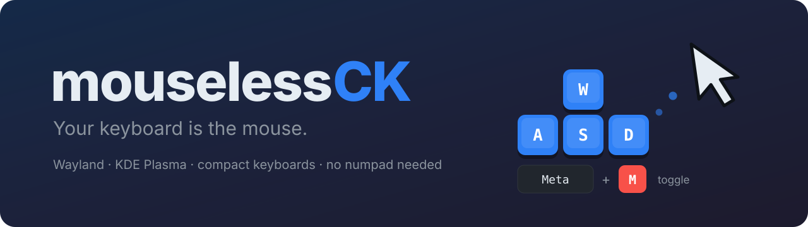
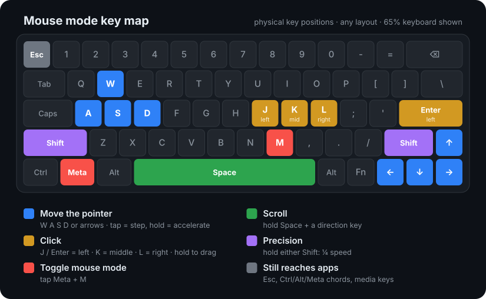
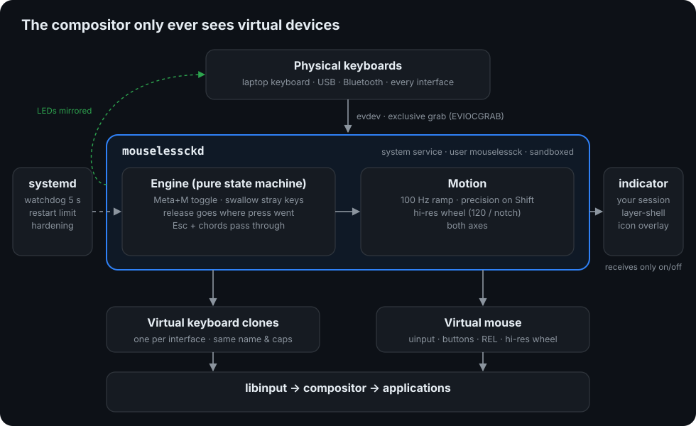

<p align="center">
  
</p>

<p align="center">
  
  
  
  
  
</p>

<p align="center">
  
  
  
  
</p>

<p align="center">
  
  
  
  
  
</p>

<p align="center">
  <b>Drive the pointer from the home row.</b> Move, click, drag and scroll with
  <kbd>W</kbd><kbd>A</kbd><kbd>S</kbd><kbd>D</kbd> or the arrows, toggled with <kbd>Meta</kbd>+<kbd>M</kbd>.<br>
  Made for compact keyboards with no numpad, on Wayland, without trusting your keystrokes to anyone.
</p>

---

## Contents

- [Why mouselessCK](#why-mouselessck)
- [Key map](#key-map)
- [How it works](#how-it-works)
- [Requirements](#requirements)
- [Installation](#installation)
- [Configuration](#configuration)
- [Safety: you cannot lock yourself out](#safety-you-cannot-lock-yourself-out)
- [Security and privacy](#security-and-privacy)
- [Compatibility](#compatibility)
- [Diagnostics](#diagnostics)
- [Known issues](#known-issues)
- [Development](#development)
- [Uninstall](#uninstall)
- [License](#license)

## Why mouselessCK

The usual answers to "use the PC without a mouse" each leave a gap on a
modern Linux desktop with a compact keyboard:

| Tool | What it does well | Why it was not enough |
| --- | --- | --- |
| Mouse Keys (built into KDE/GNOME) | Zero setup | Needs a numpad |
| warpd | Jump-to-target hints | A different paradigm; limited on Wayland |
| input-remapper, keyd, xremap | Remapping layers | No persistent mode, stray keys still type |
| ydotool | Injects input | Everything else is up to you |

mouselessCK combines a **persistent mouse mode** with the safety of modal
tools: while it is on, ordinary keys are swallowed, so a forgotten mode can
never type into a window. A translucent icon shows the mode, and leaving it
is always a deliberate key press.

## Key map

<p align="center">
  
</p>

| In mouse mode | Action |
| --- | --- |
| <kbd>Meta</kbd>+<kbd>M</kbd> | Turn mouse mode on or off (the icon appears bottom-right) |
| <kbd>W</kbd><kbd>A</kbd><kbd>S</kbd><kbd>D</kbd> or arrows | Move the pointer: a tap is a small step, holding accelerates |
| <kbd>Space</kbd> held + direction | Scroll up, down, left, right (smooth, high resolution) |
| <kbd>Shift</kbd> held (either one) | Precision: movement and scrolling at a quarter of the speed |
| <kbd>J</kbd> or <kbd>Enter</kbd> | Left click; hold while moving to drag or select |
| <kbd>K</kbd> / <kbd>L</kbd> | Middle click / right click |
| <kbd>Esc</kbd> | Reaches the application, to close menus and dialogs |
| <kbd>Ctrl</kbd>, <kbd>Alt</kbd>, <kbd>Meta</kbd> chords | Reach the application: <kbd>Ctrl</kbd>+<kbd>C</kbd>, <kbd>Alt</kbd>+<kbd>Tab</kbd>... |
| Volume and media keys | Always reach the application |
| Anything else | Ignored: nothing is typed by accident |

Mouse mode never switches itself off while you work. It does switch off when
the screen locks or the system suspends, so your password always reaches the
lock screen. Keys are physical positions: the map is the same on any layout.

## How it works

<p align="center">
  
</p>

- **`mouselessckd`**, a system service, takes exclusive hold of every keyboard
  (`EVIOCGRAB`) and republishes each interface through a virtual twin with the
  same name and capabilities. KDE per-device settings, layouts, LEDs, media
  keys and disable-while-typing keep working. In mouse mode it drives a
  virtual mouse instead.
- The decisions live in a **pure state machine** with no I/O, covered by unit
  tests. Its key invariant: a key's release always goes where its press went,
  so nothing gets stuck across mode changes.
- **`mouselessck-indicator`** runs in your session and draws the icon as a
  layer-shell overlay: above every window, never focused, clicks pass
  through. It receives only the words `on` and `off`.

Working below the compositor is what makes it independent of KDE, GNOME or
wlroots: libinput treats a uinput device exactly like real hardware.

## Requirements

| Component | Version | Notes |
| --- | --- | --- |
| Fedora | 43, 44, 45 | Other systemd distributions work with the same packages |
| Desktop | KDE Plasma 6 (tested 6.7.5) | Any Wayland compositor or X11 for the pointer; layer-shell for the icon |
| Linux kernel | with `uinput` | Loaded automatically at boot |
| Python | 3.11 or later | Uses `tomllib` from the standard library |
| python3-evdev, python3-pyudev | Fedora packages | Input devices and hotplug |
| GTK 4, gtk4-layer-shell, PyGObject | Fedora packages (layer-shell 1.3) | On-screen icon only |

Tested on a Dell laptop keyboard and a compact USB RGB keyboard that exposes
four input devices (Fedora 43, kernel 7.2, KDE Plasma 6.7.5).

## Installation

**1. Check that your desktop accepts a virtual mouse.** This touches no
keyboard:

```bash
sudo dnf install python3-evdev
sudo python3 tools/probe_mouse.py   # the pointer draws a square and the page scrolls
```

**2. Install.**

```bash
sudo ./install.sh
```

The installer adds the dependencies with dnf, installs under `/usr/local`,
creates the unprivileged `mouselessck` service user, grants it `/dev/uinput`
and checks that <kbd>Meta</kbd>+<kbd>M</kbd> is free in your KDE shortcuts.

Then it runs a **90-second trial**. The real, sandboxed service runs with a
time limit that systemd enforces no matter what. It is enabled at boot only
if you type `yes` *through* mouselessCK while it is running and holding your
keyboard. If anything misbehaves, do nothing and wait.

> [!TIP]
> One-time KDE setting: **System Settings → Mouse & Touchpad →
> mouselessCK Virtual Mouse**, turn pointer acceleration off. The speed then
> comes only from mouselessCK's own curve.

<details>
<summary><b>Install as an RPM instead</b></summary>

```bash
sudo dnf install rpm-build python3-devel python3-pytest systemd-rpm-macros
make rpm
sudo dnf install ~/rpmbuild/RPMS/noarch/mouselessck-1.0.4-1.*.noarch.rpm
sudo /usr/libexec/mouselessck/mouselessck-trial     # the same 90-second trial
systemctl --user start mouselessck-indicator
```

The RPM also installs on Fedora Atomic desktops with `rpm-ostree install`.
</details>

## Configuration

Everything lives in `/etc/mouselessck/config.toml`; every value has a
default, and the shipped file documents each one.

```toml
[toggle]
modifier = "meta"                 # "meta", "ctrl" or "alt"
key = "KEY_M"

[keys]
left_click = ["KEY_J", "KEY_ENTER"]
precision = ["KEY_LEFTSHIFT", "KEY_RIGHTSHIFT"]

[pointer]
start_speed = 120.0               # px/s on the first tap
max_speed = 1600.0                # px/s after accel_time
accel_time = 0.6                  # seconds

[indicator]
corner = "bottom-right"
```

Apply changes with `sudo systemctl restart mouselessck` and
`systemctl --user restart mouselessck-indicator`.

| Everyday task | Command |
| --- | --- |
| Status and logs (never contain keys) | `systemctl status mouselessck`, `journalctl -u mouselessck` |
| Keyboards taken over | `sudo /usr/local/libexec/mouselessck/mouselessckd --list` |
| Validate the configuration | `/usr/local/libexec/mouselessck/mouselessckd --check-config` |
| Run the trial again | `sudo /usr/local/libexec/mouselessck/mouselessck-trial` |

## Safety: you cannot lock yourself out

A program that sits between you and your keyboard must never be able to take
it away. These protections are layered, from the most convenient:

| # | Protection | What happens |
| --- | --- | --- |
| 1 | <kbd>Shift</kbd>+<kbd>Shift</kbd>+<kbd>Esc</kbd> | Both Shift keys plus Esc, checked on raw events before any other logic: the keyboards are released and the daemon exits for good |
| 2 | Fail-open | An internal error switches mouse mode off and lets every key straight through |
| 3 | Watchdog | If the daemon freezes, systemd kills it within 5 seconds and the kernel hands the keyboards back |
| 4 | Restart limit | After 3 failures in a minute systemd stops trying |
| 5 | Touchpad and mice | Never grabbed: you can always click |
| 6 | Boot escape | In GRUB press `e`, append `systemd.mask=mouselessck.service`, press <kbd>Ctrl</kbd>+<kbd>X</kbd> |

There is deliberately **no timer on mouse mode**: mouse mode is the state in
which stray keys cannot type, and a timer would turn a pause into an
accident. The timers protect you where it matters, on the daemon.

## Security and privacy

The daemon sees every key you press, passwords included, so it is small,
readable and boxed in:

- runs as the dedicated `mouselessck` user with no capabilities, never as root;
- **no network** (`RestrictAddressFamilies`, `IPAddressDeny=any`), read-only
  file system, syscall filter: `systemd-analyze security` scores it **1.3**;
- key codes never reach the logs, not even inside error messages;
- the state socket is one-way, bounded, and carries only `on` or `off`;
- no module or library can be injected through the environment
  (`python3 -I`, absolute paths).

Do not add your own user to the `input` group: it would let any program you
run read the keyboard. The full model, and how to verify each claim yourself,
is in [SECURITY.md](SECURITY.md).

## Compatibility

| Desktop | Pointer and keys | On-screen icon |
| --- | :---: | :---: |
| KDE Plasma 6 | ✅ | ✅ |
| Sway, Hyprland, niri and other wlroots compositors | ✅ | ✅ |
| COSMIC | ✅ | ✅ |
| GNOME | ✅ | ❌ |
| X11 sessions | ✅ | ❌ |

Other tools that grab keyboards (keyd, kanata, input-remapper, xremap)
cannot share a device with mouselessCK: disable them, or list the keyboard
under `[devices] ignore`.

## Diagnostics

Three probes create a temporary virtual mouse and never touch the keyboard:

| Script | Checks |
| --- | --- |
| `tools/probe_mouse.py` | The desktop accepts a virtual mouse: moves, scrolls both axes |
| `tools/probe_scroll.py` | One scroll direction at a time, started with Enter, with a summary to share |
| `tools/probe_reverse.py` | Reads libinput directly to tell whether a lost scroll is lost in the system or in an application (needs `libinput-utils`) |

## Known issues

- **Very fast horizontal reversals** (right, then left within a fraction of a
  second) can be dropped by some applications. libinput delivers them, as
  verified with `probe_reverse.py`, so the loss happens in the application.
- **GNOME** has no layer-shell, so there is no on-screen icon there.
- Holding **both** Shift keys and pressing Esc is the emergency chord, even
  while using Shift for precision.
- <kbd>Meta</kbd>+<kbd>M</kbd> taps <kbd>F24</kbd> to stop KDE from opening
  the launcher; if you bound F24 to something, change `guard_keys`.

## Development

```bash
make test    # 46 tests: state machine, motion, config, daemon wiring, safety net, security
make lint    # byte-compile and shellcheck
make rpm     # build the RPM
```

No hardware is needed for the tests: devices are faked.

```text
src/mouselessck/   engine.py (state machine) · motion.py · daemon.py · devices.py
                   ipc.py · session.py · config.py · indicator.py
data/              systemd units, udev rule, sysusers, modules-load
tools/             probes and the 90-second trial script
tests/             pytest suite
docs/              DESIGN.md (decisions) and the README images
```

Design decisions and their alternatives are in [docs/DESIGN.md](docs/DESIGN.md);
release notes are in [CHANGELOG.md](CHANGELOG.md).

## Uninstall

```bash
sudo ./uninstall.sh            # keeps /etc/mouselessck
sudo ./uninstall.sh --purge    # also removes the configuration and the service user
```

It removes only the files recorded at install time, inside the paths the
installer uses.

## License

[MIT](LICENSE) © 2026 Marko Ilincic
